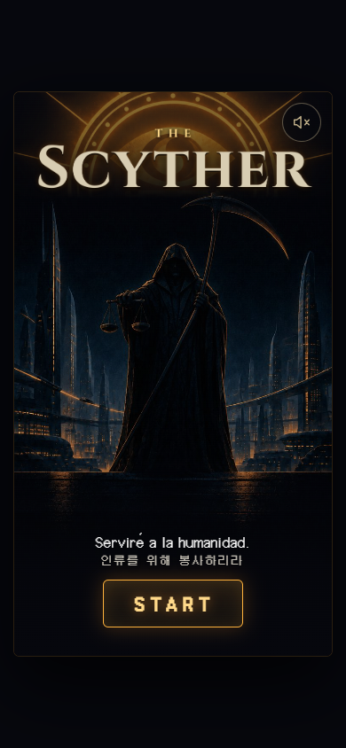
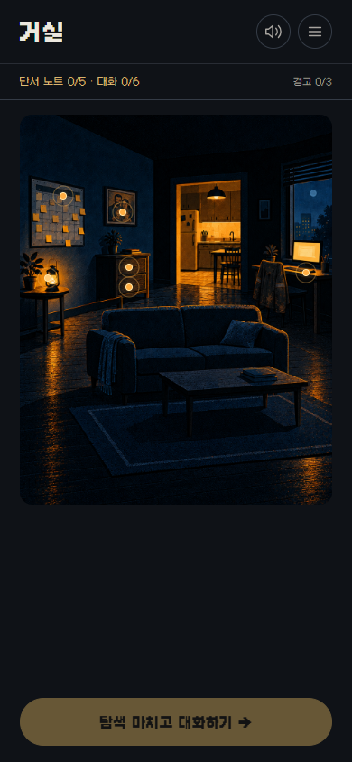
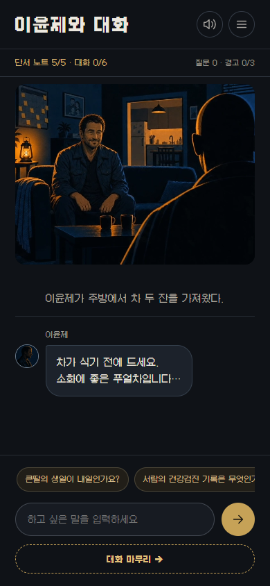

# THE SCYTHER

**인물과 대화하고 단서를 모아, 마지막 60초의 선택을 내리는 스토리 기반 AI 챗봇 게임**

닐 셔스터먼의 소설 『수확자(Scythe)』에서 출발한 HateSlop 엔지니어·프로듀서 합동 프로젝트입니다. 플레이어는 수습 수확자가 되어 한 가족의 집을 방문하고, 스승의 명령과 눈앞의 사연 사이에서 자신의 판단을 내립니다.

| 임무의 시작 | 거실 탐색 | 이윤제와의 대화 |
| :---: | :---: | :---: |
|  |  |  |

## 오늘 밤, 당신은 수습 수확자입니다

늙어도, 병들어도 자연사로 이어지지 않는 세상. 누군가는 정해진 수만큼 사람의 삶을 거두는 일을 맡습니다. 그들이 수확자입니다.

첫 임무의 대상은 공장 노동자 이윤제. 두 딸을 홀로 키우는 그의 집에서 차를 기다리는 동안, 당신은 가족의 일상과 미처 설명되지 않은 기록들을 발견합니다. 스승에게 이유를 묻고, 이윤제의 이야기를 듣고, 때로는 그 말에 반박할 수 있습니다.

마지막 판단에 주어진 시간은 60초입니다. 계율을 따를지, 사람을 살릴지, 그 사이에서 절충할지, 선택을 포기할지는 플레이어에게 달려 있습니다.

## 처음 플레이한다면

1. **START를 눌러 임무를 시작합니다.** 준비 장면에서 세계관과 계율을 확인하고 이윤제의 명단을 선택합니다.
2. **스승과 대화하고 집을 방문합니다.** 준비된 선택지를 누르거나 입력창에 직접 말할 수 있습니다. “그 선정이 공정하다는 근거는 무엇인가요?”처럼 질문하거나 반박해 보세요.
3. **거실의 물건을 조사합니다.** 그림 위 주황색 점을 눌러 달력, 가족사진, 두 서랍, 컴퓨터를 확인합니다. 다섯 물건을 모두 살펴보면 대화로 이어집니다.
4. **이윤제에게 궁금한 것을 묻습니다.** 입력창 위의 질문을 참고하거나 자신의 말로 질문하세요. 단서에 관한 대화를 나누면 관련 이미지와 기록이 나타납니다. 한 번 이상 질문한 뒤에는 ‘대화 마무리’로 진행할 수 있습니다.
5. **마지막 60초에 선택합니다.** 스승과 가족의 말을 들은 뒤 다섯 가지 선택 중 하나를 고릅니다. 이후의 보고와 수확일지를 거쳐 결과를 확인합니다. 수확일지 작성 여부는 경로에 따라 달라집니다.

대사는 한 글자씩, 상황 설명은 천천히 나타납니다. 대사와 영상 등 장면 연출이 끝나면 다음 동작이 활성화됩니다. AI 답변을 기다리는 동안에는 움직이는 점 세 개가 표시되며, 요청에 실패하면 같은 메시지를 다시 보낼 수 있습니다.

메뉴에서 **단서 노트·계율 다시 보기·엔딩 모음**을 열 수 있고, 소리는 상단 아이콘으로 조절합니다. 뒤로가기 버튼이 있는 구간에서는 앞 장면을 다시 읽을 수 있습니다. 이때 선택과 획득한 기록은 유지됩니다.

### 플레이 기록은 어디에 남나요?

진행 중인 이야기와 대화는 서버의 세션에 보관됩니다. 서버가 재시작되거나 세션이 만료되면 새 임무를 시작해야 합니다.

최종 결과까지 확인한 엔딩은 브라우저의 엔딩 모음에 저장됩니다. 새 게임을 시작해도 같은 브라우저·같은 접속 주소에서 다시 볼 수 있습니다. 저장소는 IndexedDB이며, 브라우저의 사이트 데이터를 삭제하면 함께 지워집니다.

<details>
<summary>엔딩 4종과 결과 판정 살펴보기 · 스포일러 포함</summary>

| 결과 | 선택에 담긴 방향 |
| --- | --- |
| 풀부스 · Fulvus · 금색 | 규칙을 넘어서라도 사람을 살리려는 공감형 |
| 카이룰레우스 · Caeruleus · 남청색 | 피해를 줄이는 쪽을 택하는 절충형 |
| 루베르 · Ruber · 진홍색 | 계율과 명령을 우선하는 원칙형 |
| 배드엔딩 | 수습 수확자 자격을 잃는 결말 |

최종 선택은 다섯 가지이며, 같은 결과 유형 안에서도 보고에 따라 사건의 전개가 달라질 수 있습니다. 초반에 바로 수확하는 경로도 있습니다.

공감형 선택 두 가지에는 **대화 단서 4개 이상**이 필요합니다. 거실에서 조사한 물건 5개와 대화·관찰로 얻는 단서 6개는 따로 집계합니다. 포기, 시간 초과, 경고 3회 누적, 공감형의 단서 부족은 배드엔딩 판정 조건입니다. 경고가 발생하는 입력 경로의 현재 제약은 아래 구현 범위에 적었습니다.

결과 화면에는 선택한 유형과 확인한 단서에 따른 기록이 표시됩니다. 수확일지를 작성한 경로에서는 플레이어가 남긴 글도 함께 확인할 수 있습니다. 일반·배드엔딩 모두 최종 결과 화면에서 엔딩 모음에 보관됩니다.

</details>

## 구현 설계

### 인물의 말투와 공개 가능한 지식

캐릭터 카드에 말투·가치관·배경·지식 범위를 담았습니다. 질문이 들어오면 현재 장면과 획득한 단서를 확인하고, 키워드가 관련된 Lorebook 항목을 최대 4개 골라 답변에 사용합니다. 같은 상대와 나눈 최근 대화 최대 6턴도 함께 전달합니다. 한 턴은 사용자 입력과 캐릭터 응답 한 쌍입니다.

이 구성은 Python에서 직접 작성했습니다. JSON 파일을 편집해 인물 설정과 세계관 항목을 바꿀 수 있으며, 확인되지 않은 의혹이나 잠긴 기록을 사실로 만들어 답하지 않도록 프롬프트에 지시합니다. [캐릭터와 검색 구현](services/character.py)

### 자유 입력에서 장면 전환까지

화면의 입력을 FastAPI 서버로 보내면 OpenAI Responses API가 캐릭터의 답변을 생성합니다. 선택지가 있는 장면에서는 자유 입력의 의도를 허용된 선택지 안에서 해석하고, 서버가 선택 ID와 현재 진행 상태를 검사한 뒤 장면을 전환합니다. 의도가 모호하면 확인을 요청하고, 수확 실행처럼 확인 절차가 있는 행동은 해당 절차를 거칩니다.

최종 결과는 서버에 작성한 선택·단서·경고·보고 규칙으로 계산합니다. 시나리오와 판정 규칙의 위치를 분리해 팀이 확정한 이야기를 따라가도록 구성했습니다. [대화와 진행 처리](services/game.py) · [엔딩 규칙](services/endings.py)

### 대화와 장면을 함께 읽는 화면

팀이 제작한 이미지·영상·음향을 장면에 연결하고, 대사 타이핑과 상황 설명 페이드인을 순서대로 재생합니다. 기록 이미지는 홀로그램처럼 가운데에서 위아래로 열리며, 물건은 그림 위 작은 점을 눌러 조사합니다. 최종 선택에서는 영상 위로 대화가 스크롤되어 선택지 때문에 영상 공간이 줄어드는 현상을 줄였습니다.

화면과 연출은 HTML/CSS/JavaScript로 구현했고, 효과음은 Web Audio API로 제어합니다. 완성된 결과 화면은 IndexedDB에 보관해 같은 플레이의 새로고침이나 저장 재시도로 기록이 중복 생성되지 않도록 했습니다.

## 구현 과정에서 다룬 문제

| 문제 | 적용한 처리 |
| --- | --- |
| 자유 입력이 의도하지 않은 선택을 실행하는 상황 | 현재 장면의 선택지만 허용하고, 부정·가정·모호한 표현과 확인이 필요한 행동을 추가 검사 |
| 답변 지연·오류·재시도로 대화가 중복되거나 이전 상태가 복구되는 상황 | 요청 ID와 상태 버전 검사, 생성 완료 후 상태 반영, 같은 입력의 재시도 처리 |
| 한 사용자의 생성 대기 중 다른 세션까지 지연되는 상황 | 모델 호출을 공용 잠금 밖에서 실행하고, 응답 반영 전에 세션과 장면 상태 재확인 |
| 대사가 끝나기 전 연속 클릭으로 장면을 넘기는 상황 | 텍스트·영상·홀로그램의 완료 상태를 확인해 진행 버튼과 전송 활성화 |
| 뒤로보기와 새 게임이 기록에 미치는 영향 | 앞 장면은 표시용 스냅샷으로 다시 보고, 새 임무의 세션과 브라우저의 엔딩 모음을 각각 관리 |

## 구현 범위와 검증

이윤제 시나리오의 준비부터 최종 선택과 결과까지 구현했습니다. 자유 입력을 지원하는 장면은 8개이며, 다른 두 명단 슬롯은 잠긴 상태로 표시됩니다.

2026-11-17 기준 기존 Python 테스트 **61개**와 런타임 리소스 **131개**의 참조 검사를 통과했습니다. 테스트는 세션 분리, 최근 대화 범위, 공개 가능한 지식, 선택 검증, 타이머, 엔딩 경로, 재시도와 동시 요청을 다룹니다. 모바일·PC 브라우저 검증 스크립트도 제공합니다. 실행 방법은 [검증 안내](CONTRIBUTING.md#검증)를 참고하세요.

이번 저장소 정리의 대화 검증에는 모의 응답과 대체 API 응답을 사용했습니다. 실제 모델의 말투·설정 준수·답변 품질은 별도 확인이 필요합니다.

- 진행 세션은 단일 프로세스의 메모리에 보관하며, 마지막 이용 후 12시간이 지나면 만료됩니다. 서버 재시작을 넘겨 보관할 영구 저장소는 후속 과제입니다.
- 대화 맥락은 최근 6턴 범위로 관리합니다. 세션의 전체 메시지가 600개에 도달하면 새 임무를 시작해야 합니다.
- Lorebook은 키워드와 공개 조건으로 검색합니다. 표현이 달라지면 관련 항목을 놓칠 수 있습니다.
- 자유대화 생성 경로와 기존 스크립트 경로의 경고 누적 처리는 통합이 필요한 상태입니다. 현재 생성 경로에서는 부적절한 입력이 경고 누적으로 연결되지 않습니다.
- 엔딩 모음은 브라우저와 접속 주소별로 보관됩니다. 기기 간 기록 공유와 서버의 진행 기록 영속화는 후속 과제입니다.

## 로컬에서 실행하기

Python 3.11 기준입니다. 처음 내려받은 환경에서 아래 순서로 실행합니다.

```powershell
git clone https://github.com/jaehakie/THE-SCYTHER.git
cd THE-SCYTHER
python -m venv .venv
.\.venv\Scripts\python.exe -m pip install -r requirements.txt
Copy-Item .env.example .env
.\.venv\Scripts\python.exe -m uvicorn app:app --reload
```

브라우저에서 [로컬 게임 열기](http://127.0.0.1:8000)를 선택합니다. 종료할 때는 실행한 터미널에서 `Ctrl+C`를 누릅니다. 기존 `.env`가 있다면 필요한 항목만 편집하세요.

기본 예제는 `CHAT_MODE=mock`으로 동작합니다. API 키 없이 화면·입력·진행을 확인할 수 있고, 응답에는 `[모의]`가 표시됩니다. 자연어 선택 의도의 모델 해석은 `openai` 모드에서 확인할 수 있습니다.

실제 AI 대화를 사용하려면 `.env`의 `CHAT_MODE`를 `openai`로 바꾸고, `OPENAI_API_KEY`와 이용 가능한 `OPENAI_MODEL`을 설정한 뒤 서버를 재시작합니다. 환경변수, macOS/Linux 실행, 배포와 검증 절차는 [개발 안내](CONTRIBUTING.md)를 참고하세요.

## 코드 찾아보기

| 위치 | 내용 |
| --- | --- |
| [app.py](app.py) | 웹 진입점, 세션 쿠키와 게임·대화 API |
| [services/](services/) | 장면 진행, 대화 생성, 엔딩 판정, 뒤로보기 경계 |
| [data/](data/) | 이윤제·스승 설정, 자유대화 장면과 Lorebook |
| [templates/](templates/) · [public/assets/](public/assets/) | 시작·게임 화면과 대화 연출, 이미지·영상·음향 |
| [tests/](tests/) · [scripts/](scripts/) | 서버 회귀 테스트, 리소스 검사와 브라우저 검증 |

## 팀과 참고

**낫TODAY · 김재학, 임보현, 하태호, 최송화**

프로듀서가 준비한 스토리보드·인물·시각·음향 자료를 바탕으로, 엔지니어링에서는 시나리오 진행과 결과 판정, 캐릭터 대화 연결, 화면 상호작용·연출, 기록 저장과 배포 구성을 구현했습니다.

캐릭터 카드와 Lorebook의 설계는 SillyTavern을 참고해 직접 작성했습니다. 글꼴은 Galmuri를 사용하며 저장소에 라이선스를 포함했습니다. [SillyTavern](https://github.com/SillyTavern/SillyTavern) · [글꼴 라이선스](public/assets/fonts/OFL.md)
