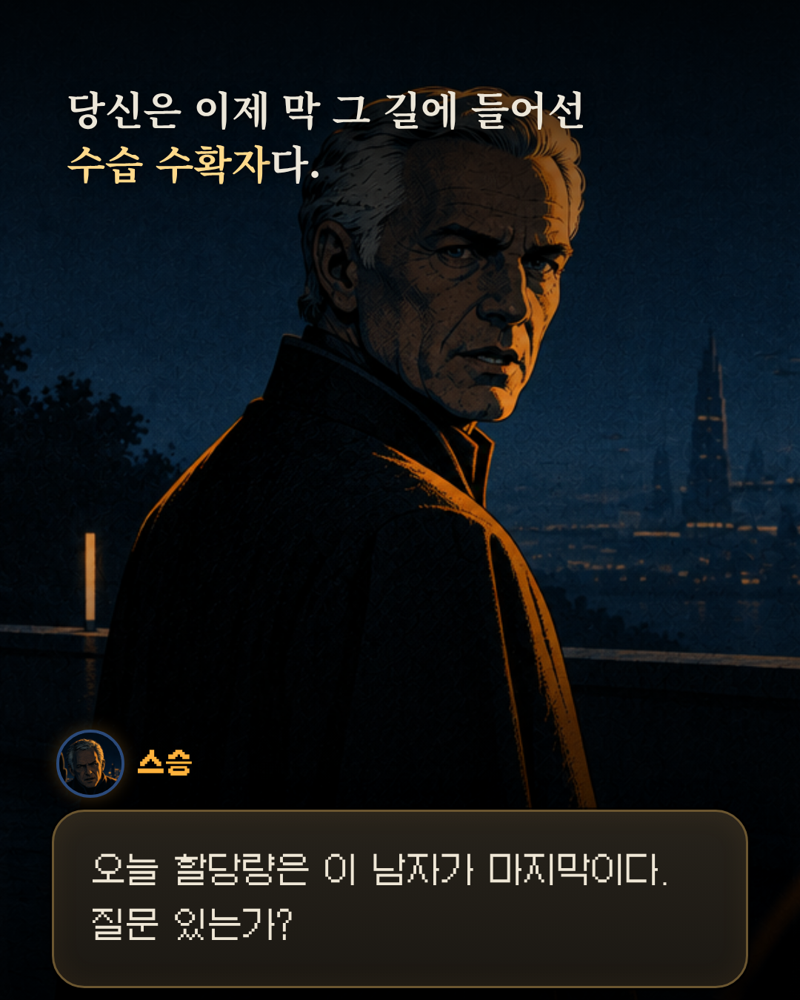
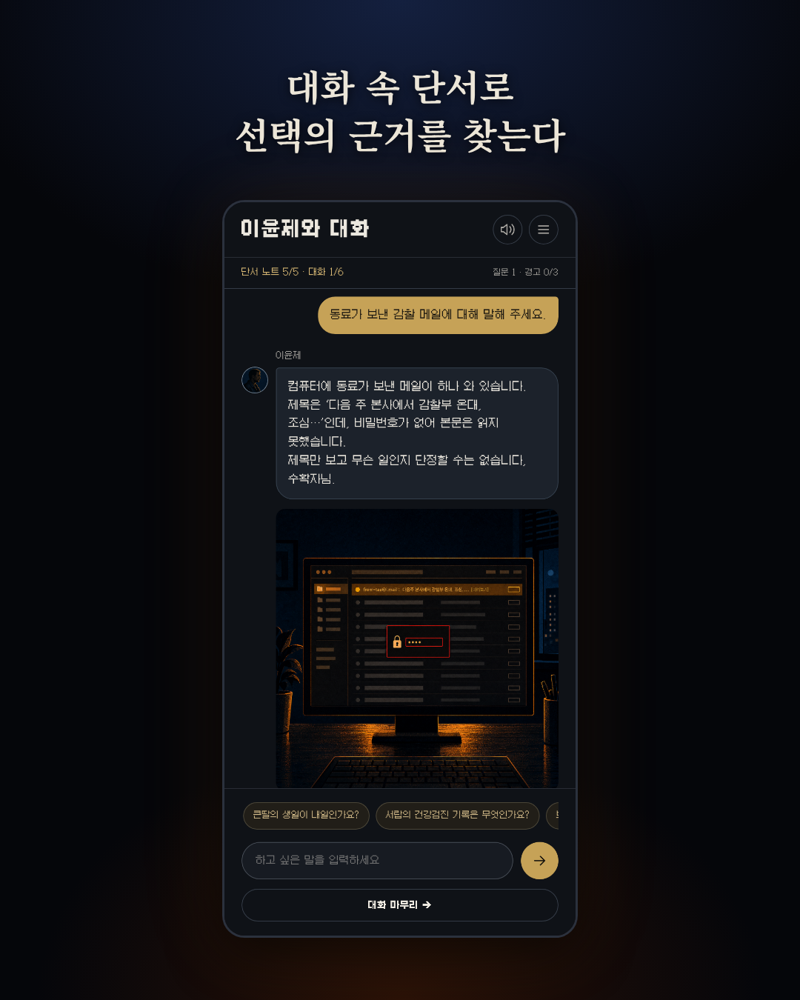
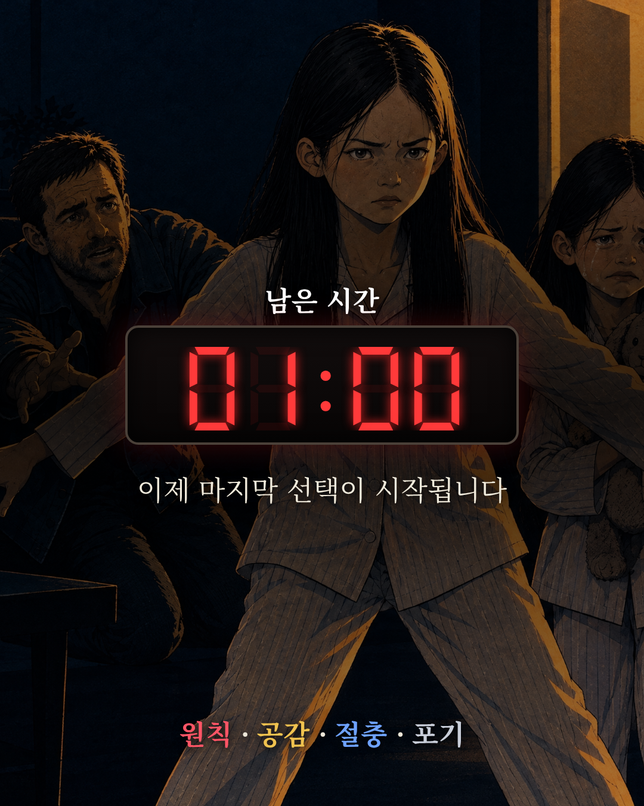
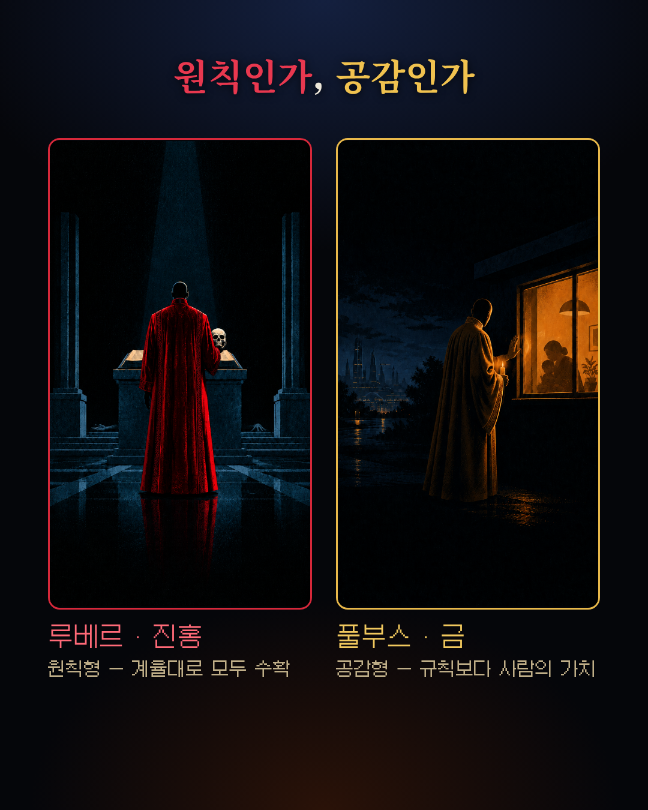
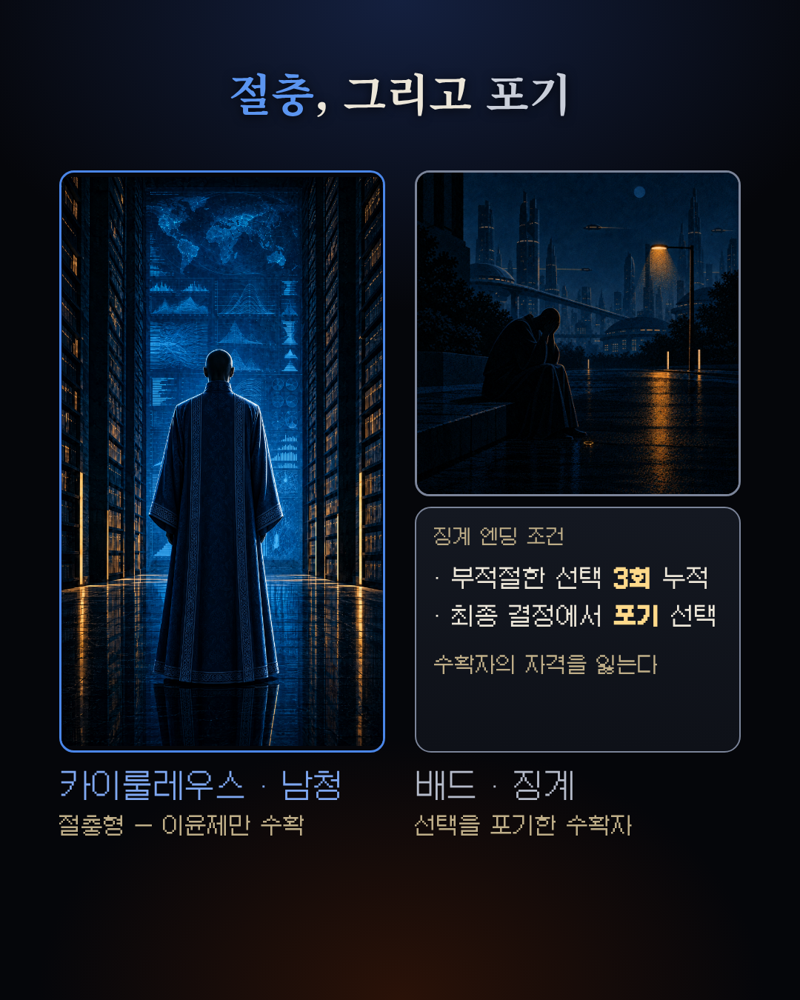

# THE SCYTHER

> **소설 『수확자』 스토리 기반 AI 챗봇**

스승에게 묻고, 집 안의 단서를 찾고, 수확 대상과 대화하며 마지막 60초의 선택을 내립니다.

## 프로젝트 개요

- **배경** · 노화와 질병으로 죽지 않는 세상에서, 정해진 수만큼 사람의 삶을 거두는 수확자의 이야기
- **플레이어** · 스승과 함께 첫 임무를 수행하는 수습 수확자
- **스토리** · 두 딸을 홀로 키우는 이윤제의 집을 방문해 일상과 의혹을 살펴보고, 계율과 사람의 가치 사이에서 판단
- **목표** · 질문·반박·탐색을 통해 선택의 근거를 쌓고, 그 선택이 만든 결과를 체험

## 프로젝트 결과

> [**THE SCYTHER 챗봇 서비스 실행링크**](https://the-scyther.onrender.com)
- **캐릭터 자유대화** · 스승·이윤제에게 준비된 질문이나 자유 입력으로 묻고, 앞선 대화를 이어가기
- **단서 탐색** · 거실 그림 위 주황색 점을 눌러 물건 5개를 조사하고, 대화로 관련 기록 확인
- **최종 선택** · 마지막 60초 동안 다섯 가지 선택 중 하나를 결정하고 이후 경로로 진행
- **엔딩 4종** · 원칙형·공감형·절충형·배드엔딩으로 이어지는 결과와 경로별 수확일지
- **장면 연출** · 대사 타이핑, 상황 설명 페이드인, 홀로그램, 주요 장면의 영상·음향
- **엔딩 모음** · 도달한 결과와 작성한 수확일지를 같은 브라우저에서 다시 확인

| 스승에게 묻기 | 대화 속 단서 | 마지막 60초 |
| :---: | :---: | :---: |
|  |  |  |

### 플레이 흐름

**START → 준비·계율 → 스승과 대화 → 집 방문 → 거실 탐색 → 이윤제와 대화 → 최종 선택 → 엔딩**

- 거실의 물건 5개를 모두 살펴본 뒤, 이윤제에게 한 번 이상 질문하면 ‘대화 마무리’로 진행할 수 있습니다.
- 대사와 장면 연출이 끝나면 계속·선택·전송 버튼이 활성화됩니다.
- 메뉴에서 단서 노트·계율·엔딩 모음을 확인하고, 상단 아이콘으로 소리를 조절합니다.

<details>
<summary>엔딩 유형 보기 · 스포일러 포함</summary>

| 원칙형 · 공감형 | 절충형 · 배드엔딩 |
| :---: | :---: |
| [](.github/images/ending-principle-empathy.png) | [](.github/images/ending-compromise-bad.png) |

최종 선택과 모은 단서, 이후의 보고에 따라 사건의 전개와 결과가 달라집니다. 일반·배드엔딩 모두 최종 결과 화면에서 엔딩 모음에 보관됩니다.

</details>

## 주요 구현

| 구분 | 구현 내용 |
| --- | --- |
| 캐릭터 대화 | 캐릭터 카드·현재 장면·최근 대화 최대 6턴을 조합해 OpenAI Responses API로 답변 생성 |
| 세계관 검색 | 키워드로 Lorebook 검색 → 현재 장면·획득 단서의 공개 조건 확인 → 관련 항목 최대 4개를 프롬프트에 반영 |
| 이야기 진행 | 자유 입력의 선택 의도 해석 → 서버에서 허용된 행동 검사 → 장면 전환과 정해진 엔딩 규칙 적용 |
| 화면·기록 | 순차 대사와 이미지·영상·음향 연출, IndexedDB를 이용한 브라우저 내 엔딩 모음 저장 |

진행 중인 대화는 서버의 메모리 세션에 보관되며, 서버 재시작이나 세션 만료 시 새 임무를 시작합니다. 엔딩 모음은 같은 브라우저·접속 주소에서 유지됩니다.

[캐릭터·세계관 검색](services/character.py) · [게임 진행](services/game.py) · [엔딩 규칙](services/endings.py)

## 로컬에서 실행하기

Python 3.11 기준으로 처음 내려받은 환경에서 실행합니다.

```powershell
git clone https://github.com/jaehakie/THE-SCYTHER.git
cd THE-SCYTHER
python -m venv .venv
.\.venv\Scripts\python.exe -m pip install -r requirements.txt
Copy-Item .env.example .env
.\.venv\Scripts\python.exe -m uvicorn app:app --reload
```

[로컬 게임 열기](http://127.0.0.1:8000)에서 START를 누르면 시작합니다. 기존 `.env`가 있다면 필요한 항목만 편집하세요.

- **모의 체험** · 기본 예제의 `CHAT_MODE=mock`으로 API 키 없이 화면·진행 확인
- **AI 대화** · `CHAT_MODE=openai`, `OPENAI_API_KEY`, 이용 가능한 `OPENAI_MODEL`을 설정한 뒤 서버 재시작
- **개발 안내** · 환경 설정과 콘텐츠 편집 위치는 [CONTRIBUTING.md](CONTRIBUTING.md)에서 확인

## Authors : 낫TODAY

- 서강대학교 생성형AI 미디어&테크 학회 [HateSlop](https://www.instagram.com/hateslop/) 소속 프로젝트 팀 낫TODAY
### 김재학 | ENGINEER
- 서강대학교 수학 & 컴퓨터공학 & 빅데이터사이언스 학사과정
### 임보현 | ENGINEER
- 서강대학교 아트앤테크놀로지학 학사과정
### 최송화 | PRODUCER
- 서강대학교 아트앤테크놀로지학 학사과정
### 하태호 | PRODUCER
- 서강대학교 신문방송학 학사과정

## 참고

- **원작** · 닐 셔스터먼, 『수확자(Scythe)』
- **설계 참고** · SillyTavern의 캐릭터 카드·Lorebook 구조를 참고해 자체 구현. [SillyTavern 저장소](https://github.com/SillyTavern/SillyTavern)
- **글꼴** · Galmuri. [라이선스](public/assets/fonts/OFL.md)
