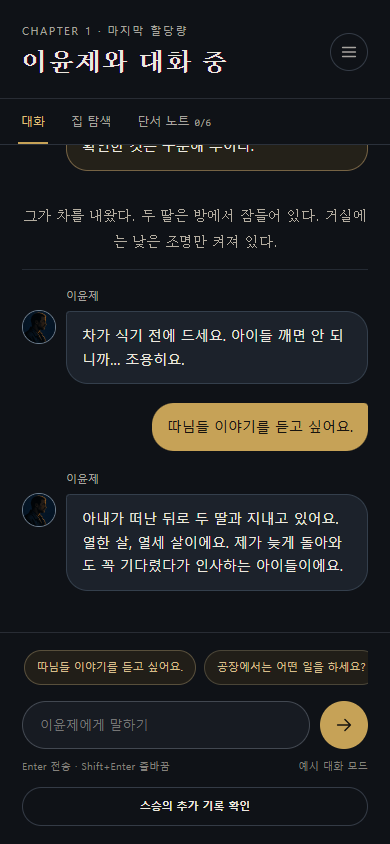
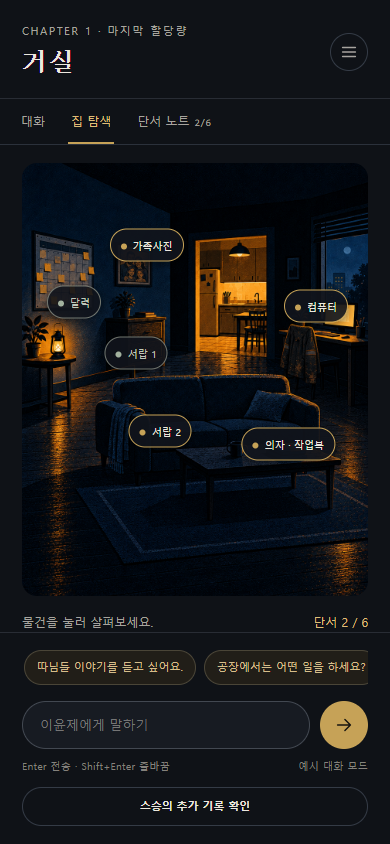

# NOT-TODAY · 낫 TODAY

이윤제와 대화하고 집 안의 단서를 확인한 뒤 수확 여부를 판단하는 회의용 프로토타입입니다.
팀 공유 저장소: [jaehakie/NOT-TODAY](https://github.com/jaehakie/NOT-TODAY) (private).
HateSlop 베이스를 참고해 HTML/CSS/JavaScript와 FastAPI로 새로 구현했습니다.
배포 플랫폼은 Render로 정했으며, 아직 배포하지 않았습니다.

## 팀원이 처음 받는 방법

저장소 collaborator 초대를 수락하고 본인의 GitHub 계정으로 인증한 뒤 받으세요.

```powershell
git clone https://github.com/jaehakie/NOT-TODAY.git
cd NOT-TODAY
```

이후 아래 실행 명령을 사용합니다. 작업을 합치는 방법과 커밋 규칙은 [CONTRIBUTING.md](CONTRIBUTING.md)에 있습니다.

## 실행

Python 3.11 이상을 사용합니다. Windows PowerShell에서 현재 폴더를 열고 실행하세요.

```powershell
python -m venv .venv
.\.venv\Scripts\python.exe -m pip install -r requirements.txt
.\.venv\Scripts\python.exe -m uvicorn app:app --reload
```

브라우저에서 <http://127.0.0.1:8000>을 엽니다. 종료는 터미널에서 `Ctrl+C`입니다.
다음부터는 마지막 명령만 실행하면 됩니다. 실제 모델 API 키는 필요하지 않습니다.

macOS/Linux에서는 가상환경 Python 경로만 바꿉니다.

```bash
python3 -m venv .venv
.venv/bin/python -m pip install -r requirements.txt
.venv/bin/python -m uvicorn app:app --reload
```

## 화면 미리보기

노션 목업의 검은 배경·금색 버튼·명조체 제목과 팀이 제공한 이미지를 사용합니다.

| 이윤제와 대화 | 집 안 탐색 |
| --- | --- |
|  |  |

## 회의 시연 순서

1. 이윤제 정보 열람 → 기록을 읽고 스승에게 질문 → 이윤제의 집으로 이동합니다.
2. 제안 질문을 누르거나 직접 입력해 대화합니다. Enter 전송, Shift+Enter 줄바꿈입니다.
3. 집 탐색 탭에서 달력·사진·서랍 등을 눌러 확인하고 단서 노트를 엽니다.
4. ‘진단서에 대해 말씀해주세요’, ‘서랍을 열어본다’ 등을 입력해 단서에 따른 반응을 확인합니다.
5. 스승의 추가 기록을 확인하고 의혹을 직접 묻습니다. 기록은 사실로 확정하지 않습니다.
6. 판단 내리기 → 최종 선택 → 선택 확정 → 결과를 확인합니다.

## 구현 상태와 한계

- **실제 LLM을 아직 연결하지 않았습니다.** `services/dialogue.py`의 주제·키워드 기반 예시 대화입니다. 메뉴와 입력창 아래에도 예시 모드를 표시합니다. 임의의 모든 질문을 이해하지는 못합니다.
- 자유 입력과 제안 질문, 직전 대화 주제에 대한 후속 응답, 단서 확인 여부, 추가 정보 공개 여부를 반영합니다.
- 최종 선택은 확인 버튼을 거쳐 서버가 확정합니다. 유형은 최종 선택으로, 설명은 확인한 단서 목록으로 정합니다. 유형은 회의 후 변경 가능합니다.
- 커스터마이징, 실제 타이머, 다른 대상자, 복잡한 자유 행동, 후속 회차는 제외했습니다.
- 기록은 무작위 HttpOnly 쿠키로 구분하며 **서버 메모리에 임시 저장**합니다. 같은 서버 실행 중 새로고침은 가능하지만, 서버 재시작·자동 재시작·다중 프로세스에서는 유지되지 않습니다. 공개 서비스용 저장 방식이 아닙니다.
- 사용자당 100회 대화, 12시간 세션, 최대 500세션으로 제한합니다. 운영용 요청 제한·인증은 별도 작업입니다.
- PostgreSQL, 실제 모델 호출과 실제 배포는 아직 진행하지 않았습니다.
- Figma로 전달된 최신 스토리는 아직 읽고 대조하지 못했습니다. 현재 내용은 기존 Notion 기획을 기준으로 합니다.

## 구성

- `app.py`: 화면 제공, FastAPI 요청 검증, 세션 쿠키
- `services/game.py`: 장면 전환·단서 공개·선택·결과, 임시 저장소
- `services/dialogue.py`: 회의용 예시 대화, 향후 모델 연결 경계
- `templates/index.html`: 화면 진입점
- `public/assets/css/style.css`, `public/assets/js/app.js`: 목업에 맞춘 화면과 상호작용
- `public/assets/images/`: Notion에서 제공된 장면 원본
- `reference/`: 디자인 대조용 목업. 웹으로 공개하지 않습니다.
- `reference/assets.json`: 이미지 로컬 파일명과 Notion 원본 참조의 대응표
- `docs/screenshots/`: 팀 공유용 대표 화면 캡처
- `CONTRIBUTING.md`, `AGENTS.md`: 협업·커밋 규칙

후속 작업에서는 임시 세션 저장을 PostgreSQL로 교체하고, 현재 장면·공개된 단서·대화 기록을 전달하는 모델 생성기를 연결합니다. 화면의 API 주소는 현재 동일 출처 상대 경로입니다. Render/Vercel 전용 로직은 게임 서비스에 넣지 않았습니다.

## 검증

```powershell
.\.venv\Scripts\python.exe -m pip install -r requirements-dev.txt
.\.venv\Scripts\python.exe -m unittest discover -s tests -v
```

사용자별 기록 분리, 새로고침·재시작 처리, 단서 중복 방지, 미발견 정보 비공개, 직전 주제 참조, 잘못된 단계 이동, 중복 요청, 다섯 엔딩을 검증합니다. 실제 LLM 품질 검증은 포함하지 않습니다.

서버를 실행한 상태에서, 로컬 Microsoft Edge가 설치되어 있다면 브라우저 흐름도 확인할 수 있습니다.

```powershell
.\.venv\Scripts\python.exe scripts/verify_ui.py
```

이번 구현에서 서버 테스트 10개와 Edge 브라우저의 전체 플레이 흐름이 통과했습니다. 모바일 390×844, 데스크톱 1280×900에서 화면을 확인했으며 JavaScript 오류·이미지 로딩 실패가 없었습니다. 캡처는 `reference/qa/`에 저장합니다.

## 다음 작업

1. 프로듀서의 최신 스토리를 대조하고 장면·단서·대사·분기를 확정합니다.
2. 콘텐츠와 게임 진행 로직을 분리하고 실제 AI 모델을 연결합니다.
3. PostgreSQL로 진행 기록을 저장하고 대화 품질·오류 복구를 검증합니다.
4. Render 배포와 공개 시연을 준비합니다.

타이머, 자유 행동의 허용 범위, 상세 계율, 최종 유형 판정은 회의에서 확정합니다.
커스터마이징·다른 대상자·음성·후속 회차는 후순위입니다.

## 출처

- [팀 Notion 기획·목업](https://app.notion.com/p/jaehakie/TODAY-403ee9a4047c803fbd0de0089c2254a3): 장면 이미지·인물·단서·선택·유형, 검은 배경·금색 버튼·명조체 제목의 디자인 기준
- [HateSlop 참고 베이스](https://github.com/HateSlop/5-chatbot-base): 프로젝트 범위와 서비스 경계 참고. 이 프로젝트는 FastAPI로 새로 작성했습니다.

회신 문구 일부는 미정인 이야기를 확정하지 않는 범위에서 작성한 시연용 문장입니다. 이미지의 `notion-N.png`는 로컬 식별자이며 만료되는 Notion 다운로드 주소를 사용하지 않습니다. 공개 배포·저장소 공개 전에 팀 콘텐츠의 공개 범위를 확인하세요.
